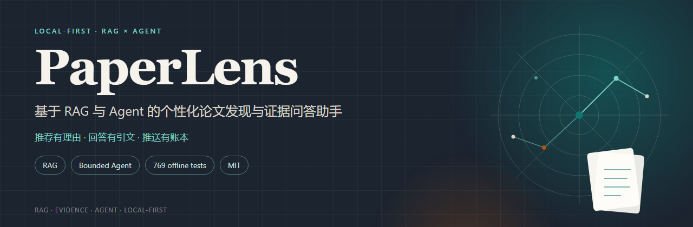
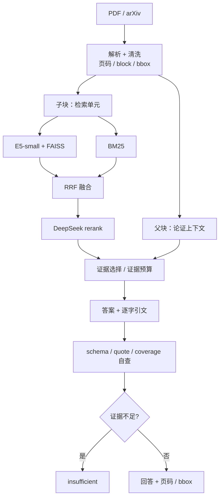
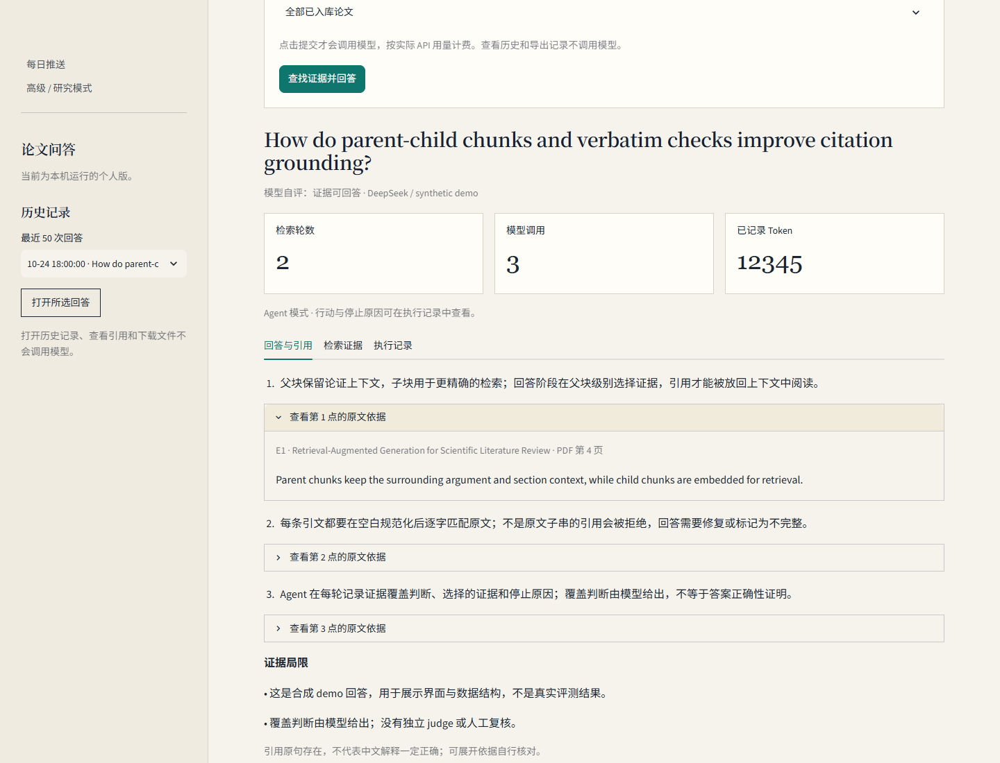
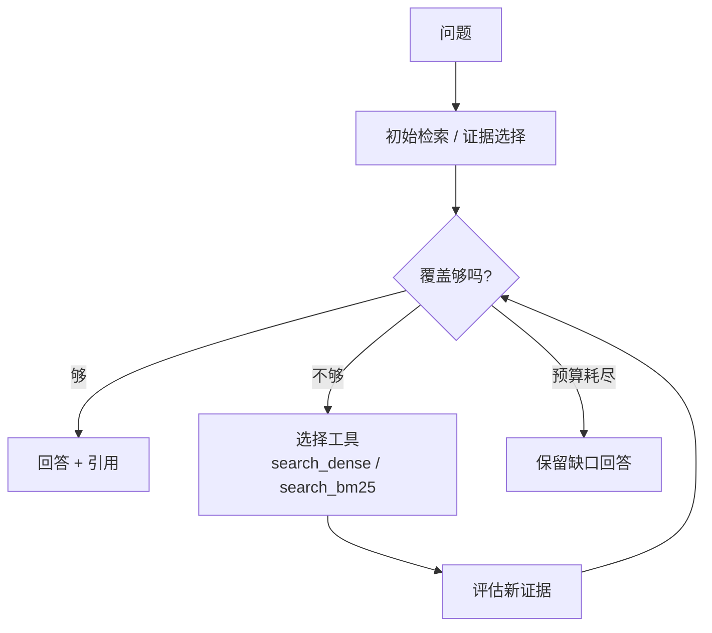
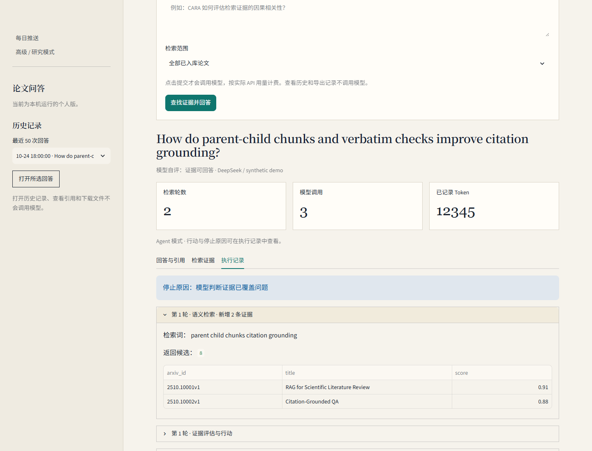
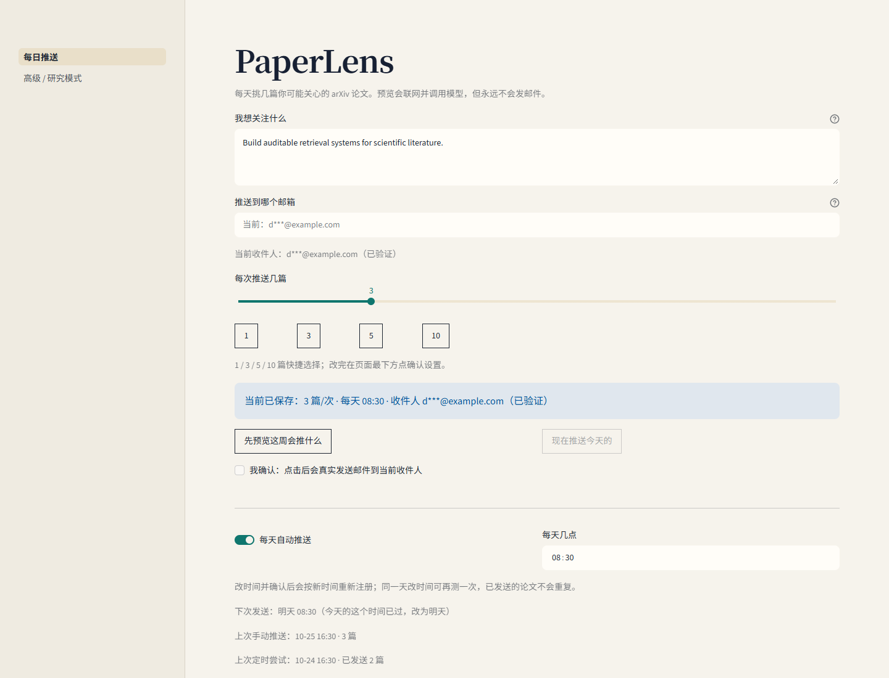
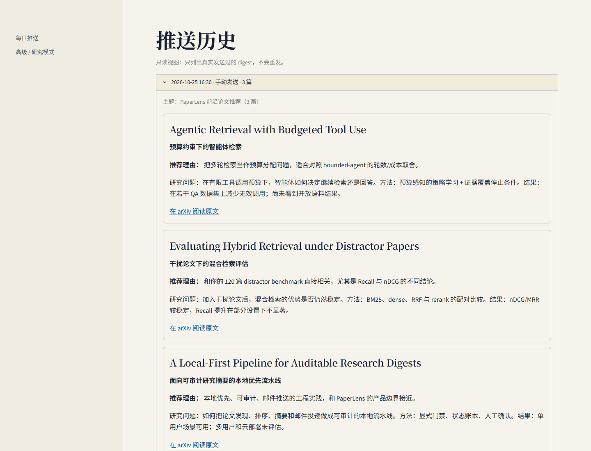
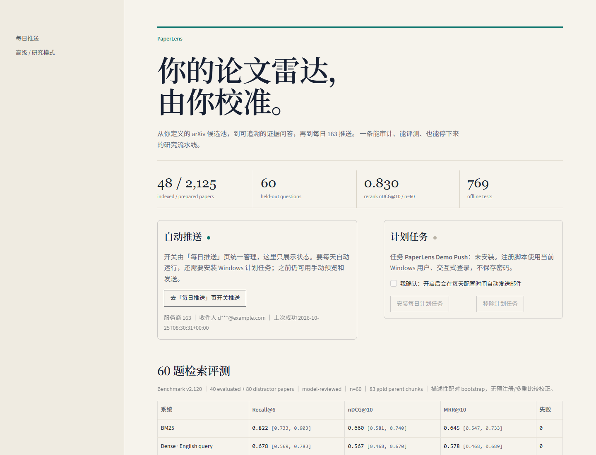
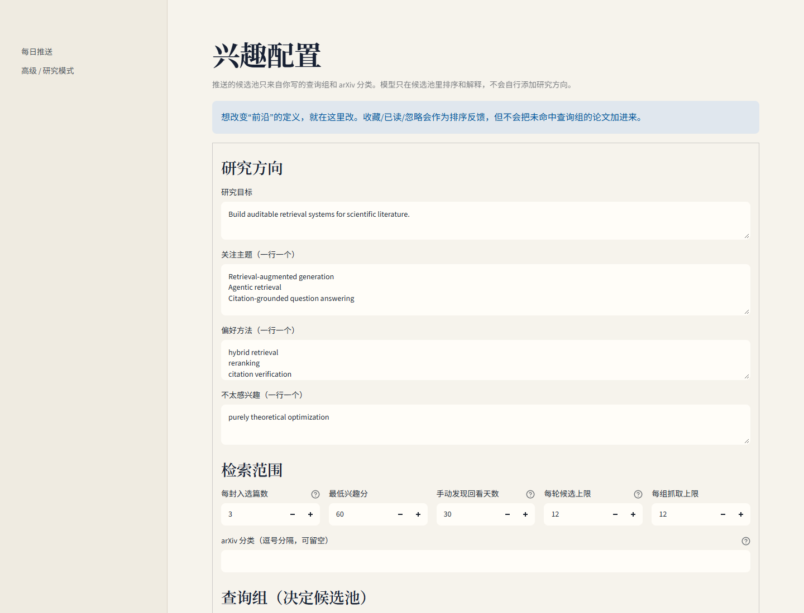
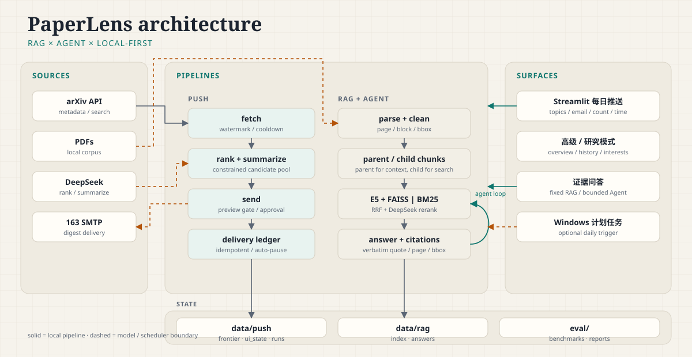

<div align="center">

<h1>PaperLens</h1>

<p><strong>基于 RAG 与 Agent 的个性化论文发现与证据问答助手</strong></p>

<p>推荐有理由 · 回答有引文 · 推送有账本 · 本地优先</p>

<p>
<a href="https://www.python.org/"></a>
<a href="https://streamlit.io/"></a>
<a href="#测试"></a>
<a href="LICENSE"></a>
<a href="#隐私与安全"></a>
</p>

<p><a href="#quickstart">快速开始</a> · <a href="#features">功能</a> · <a href="#screenshots">截图</a> · <a href="#rag">RAG</a> · <a href="#agent">Agent</a> · <a href="#architecture">架构</a> · <a href="#evaluation">评测</a> · <a href="#privacy">隐私</a> · <a href="#english">English</a></p>

</div>




<a id="what"></a>
## ✨ 这是什么

PaperLens 是一个 **论文推送助手**：基于 RAG 与 Agent，做个性化论文发现、证据问答和每日摘要。它是本地优先的，三件事串成一条能停下来、能检查的流水线：

- **个性化发现**：你写一段主题 → 生成 1–3 组 arXiv 查询 → 候选池只来自这些查询组和 arXiv 分类。模型只在候选池内排序和解释，不会自行扩展研究方向。
- **证据问答**：对论文原文提问，返回逐字引文、页码/bbox、schema 与覆盖自查；证据不足时明确返回 `insufficient`，不硬编答案。
- **每日摘要**：把当天的候选排序、生成中文摘要、通过 163 SMTP 发送。预览永远不发信；真实发送要人工批准；投递账本防止重复。
- **评测可复现**：60 题 held-out benchmark、BM25/dense/RRF/rerank 对照、答案级 citation 指标、固定 RAG vs bounded Agent 的 A/B harness。

<a id="why"></a>
## 🆚 为什么不是另一个聊天框

| 常见做法 | PaperLens 的做法 |
|---|---|
| 模型自由决定搜什么 | 候选池由你的查询组 + arXiv 分类显式定义；模型只排序 |
| 引用看起来对就行 | 逐字引文校验、页码/bbox、schema/coverage 自查 |
| 只报一个“准确率” | 区分 retrieval / citation / answer-level；不把 citation 指标包装成 accuracy |
| 默认云端、上传数据 | 本地优先；`data/` 和 `.env` 不进仓库；无遥测 |
| 推送不可审计 | preview/send 门禁、delivery ledger、watermark、失败暂停 |

<a id="features"></a>
## 🚀 功能一览

| 模块 | 能力 | 设计 |
|---|---|---|
| **个性化发现** | 主题 → 1–3 组 arXiv 查询 → 候选池；模型只在池内排序和解释 | 查询组显式可查，不偷偷扩展研究方向 |
| **RAG 证据问答** | 父/子块、E5 + FAISS、BM25、RRF、DeepSeek rerank、逐字引文 | 引文必须回到原文；页码/bbox 可核对 |
| **Bounded Agent** | 证据不足时补检索；最多 3 轮 / 4 次模型调用 / 6 条证据 | 预算、决策 JSON、stop_reason、完整 trace |
| **每日推送** | 主题、邮箱、篇数、时间；预览不发信、测试邮件、手动/自动推送 | preview/send 门禁、投递账本、watermark、自动暂停 |
| **评测** | 60 题检索 benchmark、120 篇 distractor、答案级 citation、Agent A/B harness | 区分 retrieval / citation / answer-level，不包装成 accuracy |
| **隐私** | `data/`、`.env`、真实 profile 不进仓库；UI 掩码邮箱；无遥测 | 单用户本地优先；公开 demo 必须用合成数据 |

### 🧱 技术栈

| 层次 | 技术 | 职责 |
|---|---|---|
| 交互与展示 | **Streamlit 1.66** | 每日推送、测试邮件、高级研究页、推送历史 |
| 检索 | **E5-small + FAISS + BM25 + RRF** | 语义/关键词检索、父块融合 |
| 重排与回答 | **DeepSeek（OpenAI-compatible）** | 候选重排、中文摘要、证据问答 |
| 存储 | **SQLite + JSON** | frontier / runs / ui_state / profile |
| 投递 | **163 SMTP + Windows Task Scheduler** | 每日摘要、手动发送、可选计划任务 |
| 解析 | **PyMuPDF** | PDF 解析；注意 AGPL/商业双许可 |
| 测试 | **unittest** | 769 项离线测试；Playwright 只用于合成 demo 截图 |

<a id="rag"></a>
## 🔬 RAG 流水线

PaperLens 的 RAG 不是“把 top-k 丢给模型”，而是把**来源、切块、检索、重排、引用**都做成可检查的步骤：



- **来源可追溯**：每个片段保留 arXiv id、PDF 页码、block/bbox、父子块关系；manifest 用哈希链。
- **检索可对照**：BM25 / dense E5 / RRF / rerank 都能在同一 benchmark 上跑；结果见下文。
- **引用可校验**：引文必须是原文的空白规范化子串；页码/bbox 可以回到原文。
- **不足会拒答**：证据覆盖不足时返回 `insufficient`，不编造。

**数据规模**

| 资产 | 数量 | 说明 |
|---|---:|---|
| prepared 全文 | 2,125 篇 / 42,682 页 / ~1.515 亿字符 | 不是已索引语料 |
| 产品索引 | 48 篇 / 16,648 父块 / 2,997 向量 | 8 dev + 40 benchmark |
| 检索 benchmark | 120 篇（40 evaluated + 80 distractor） | 60 题 |
| qrels | 145 gold points → 132 mapped / 83 parent chunks | 13 个未匹配；40/60 题只有 1 个 gold parent |
| 离线测试 | 769 | 753 + 16 |

**检索与引用契约**

| 阶段 | 实现 | 可检查点 |
|---|---|---|
| 解析 / 清洗 | PyMuPDF；页码 / block / bbox；无 OCR | 页级结构检查 |
| 父 / 子块 | 父块保留上下文，子块做检索；child offsets/text 必须匹配 parent | `retrieval_core.load_index` 结构校验 |
| 向量 | `intfloat/multilingual-e5-small`，384d，normalized，FAISS `IndexFlatIP` | 维度 / 归一化 / 重复 ID |
| 关键词 | BM25Okapi `k1=1.5, b=0.75`；英文 query | 父块去重 |
| 融合 | RRF（dense + BM25） | 父块级融合 |
| 重排 | DeepSeek LLM rerank | candidate / evidence 预算 |
| 回答 | 答案 points + citations；quote 必须是原文空白规范化子串 | 逐字引文；公式扩展 ≤800 字 |
| 质量 | schema / coverage 自查 | 结构与序号一致性；不判断语义正确 |
| 拒答 | 证据不足 → `insufficient` | 12/12 out-of-scope 检查 |

**中文 query rewrite**：`query_rewrite.py` 做 page-blind 的中文问题 → 英文检索 query 翻译，只看问题、不看检索结果；带缓存与失败回退，`PAPERLENS_QUERY_REWRITE=0` 可关闭。产品 48 篇索引上做过一次中文 smoke；还没有正式对照，不能写收益。

**答案级指标（n=60，复用 120 篇 rerank 证据，含一次 repair）**

| 指标 | 值 | 口径 |
|---|---:|---|
| answered / partial / invalid | 47 / 9 / 4 | n=60 |
| schema + 逐字引文 | 93.3% | deterministic；不是 correctness |
| cited gold-parent recall | 82.2% [0.722, 0.917] | 保守口径 |
| gold-point citation recall | 77.4% [0.676, 0.864] | 保守口径 |
| cited gold-parent precision | 62.9% | answered/partial（n=56） |
| citation occurrence gold-quote precision | 68.1% | 同上 |
| tokens | 169,306 | 一次 repair |
| p95 latency | 5.38s | |

**Benchmark 的诚实边界**

- model-reviewed，`human_reviewed=false`；没有人工核验、κ 或独立 judge。
- 13/145 gold points 未映射到 parent chunk；40/60 题只有 1 个 gold parent。
- query 审计：query 与 gold quote 平均 40.8% token 重叠，5/60 存在 4-gram 重叠；benchmark 仍可能偏易。
- 40 篇 closed-world 的 rerank Recall@6 0.908 **不能**当开放语料结论；加入 80 篇 distractor 后是 0.872，且 Recall 相对 BM25 的 CI 跨 0。
- repair 只修 schema/引文，不判断 claim 是否正确；这不是 answer accuracy / faithfulness。

**RAG 代码地图**

| 文件 | 作用 |
|---|---|
| `ingest_library.py` / `clean_corpus.py` / `library_transaction.py` | PDF 入库、清洗、父子块、哈希链与原子发布 |
| `build_vector_index.py` / `retrieval_core.py` | E5 384d + FAISS、BM25、RRF、parent 校验 |
| `search_evidence.py` / `search_bm25.py` / `rerank_evidence.py` | 语义检索、关键词检索、LLM 重排 |
| `query_rewrite.py` | page-blind 中文 query rewrite |
| `answer_question.py` / `answer_schema.py` / `answer_quality.py` | 答案、schema、逐字引文、覆盖自查 |
| `run_qa.py` | 固定 RAG CLI |
| `eval/` | benchmark、qrels、检索/答案报告 |



> 合成 demo 回答：展示答案、检索轮数、Token 与逐字引文；不是真实评测结果。

<a id="agent"></a>
## 🤖 Agent：有预算的补检索

固定 RAG 是“一次检索 → 一次回答”。PaperLens 还实现了一个 **bounded agent**：证据不足时可以补检索，但轮数、证据和模型调用都有预算，并且每一步都留 trace。



- **工具**：`search_dense`（E5/FAISS 语义检索）与 `search_bm25`（关键词检索）。
- **预算**：最多 3 轮检索、4 次模型调用、6 条证据预算；达到预算就停，不无限循环。
- **可审计**：`agent_trace` 记录每轮 query、候选、覆盖自评、选择证据和停止原因；`agent.stop_reason` 解释为什么停。
- **对照**：`eval/agent_eval.py` 用同一证据预算/同一 answer prompt 对比 `fixed_rag`、`agent_single`、`agent_multi`；输出 schema/quote/citation recall、tool calls、rounds、tokens、latency。
- **诚实边界**：harness 31 项离线测试通过；真实付费 pilot 只有 n=5，无显著性；完整 60 题 A/B 未跑。不能写多轮收益或成本结论。

**工具（只读）**

| 工具 | 检索方式 | 语言 | 约束 |
|---|---|---|---|
| `search_dense` | E5 + FAISS 语义检索 | 中文 / 英文 | query 长度与 token 上限校验 |
| `search_bm25` | BM25Okapi 关键词 | 英文 | 中文 query 会被拒绝 |

工具只读：不联网、不执行代码、不写文件、不发邮件；`paper_filter` 固定，不能让 Agent 自行扩大论文范围。

**决策 JSON**

| 字段 | 允许值 / 约束 |
|---|---|
| `assessment` | `sufficient` / `partial` / `insufficient`；必须与 selected/missing/action 一致 |
| `missing` | 最多 6 项，每项 1–300 字；sufficient 必须为空，partial/insufficient 必须非空 |
| `selected_ids` | 最多 6 个，必须来自候选；sufficient/partial 至少 1 个；insufficient 为空 |
| `action` | `search_dense` / `search_bm25` / `finish`；finish 时 query 为空；BM25 只接受英文 |
| `query` | ≤500 字；非 finish 必须有有效 query |
| `reason` | 1–240 字，面向用户的简短行动依据，不输出内部推理 |

**预算与限制**

| 限制 | 值 |
|---|---:|
| 检索轮数 | 3 |
| 模型调用 | 4 |
| 回答证据 | 6 |
| decision output tokens | 1,600 |
| answer output tokens | 4,096 |
| API timeout | 120s |
| automatic retries | 0 |

**停止原因**

| `stop_reason` | 含义 |
|---|---|
| `sufficient` | 模型判断证据已覆盖问题 |
| `model_stopped_with_gaps` | 保留缺口，结束检索 |
| `round_budget` | 达到检索轮数上限 |
| `call_budget` | 达到模型调用预算，预留最终回答 |
| `repeated_query` | 拦截重复查询 |
| `no_new_evidence` | 补检索没有带来新证据 |
| `empty_retrieval` | 没有检索到可用证据 |

**执行记录**

| event | 字段 |
|---|---|
| `retrieval` | `round`, `tool`, `query`, `new_count`, `candidate_count`, `sources` |
| `decision` | `round`, `assessment`, `reason`, `action`, `selected_ids`, `missing` |

`agent_trace` 是执行记录，不是答案正确性的证明；覆盖判断由模型给出，程序只校验结构与一致性。

**A/B harness**

| 模式 | 行为 | 同一约束 |
|---|---|---|
| `fixed_rag` | 一次检索 + 一次回答 | 6 条证据预算；同一 answer prompt |
| `agent_single` | 1 轮决策 + 回答 | 同上 |
| `agent_multi` | 最多 3 轮补检索 | 同上 |

harness 输出 schema/quote、cited gold parent、gold-point citation、tool calls、rounds、tokens、latency；31 项离线测试通过。真实 pilot n=5，只作 harness 跑通与描述性观察，不构成收益结论。

**它不是**：通用 tool-use agent、浏览器/代码执行器、多智能体系统或微调模型。它只是**有预算的本地检索控制器**；没有多轮收益、成本或泛化结论。



> 合成 demo trace：展示检索轮次、候选、证据覆盖、停止原因与 Token；不是真实评测结果。详见 [README_AGENT_EVAL.md](README_AGENT_EVAL.md)。

<a id="engineering"></a>
## 🧩 工程难点

### 01 · 父子块与逐字引文

**问题：** 检索单元太细会丢上下文，太粗会降低召回；模型生成的引用又经常“看起来像原文”，实际不是。

**处理：** 父块保留论证上下文，子块做检索；`retrieval_core` 校验 child offsets/text 必须落在 parent 内；引文在空白规范化后必须是原文子串，公式允许有限扩展（≤800 字）；页码/bbox 随证据保存。

**取舍：** 逐字校验证明“引文存在”，不证明“claim 正确”；公式扩展和句界检查仍可能漏报或误报。

### 02 · 检索评测的分布偏移

**问题：** 40 篇 closed-world 上的高 Recall 不代表开放语料；加入 distractor 后 Recall 可能不稳定。

**处理：** 建 120 篇语料（40 evaluated + 80 distractor）、60 题、parent-chunk qrels；同时报告 Recall@6 / nDCG@10 / MRR@10；做 query 审计（query 与 gold quote 平均 40.8% token 重叠，5/60 有 4-gram 重叠），并明确 13/145 gold points 未映射。

**取舍：** 主结果仍是固定 120 篇、model-reviewed、无预注册；40 篇的 rerank Recall 0.908 只作历史对照，不能外推。

### 03 · Agent 预算与停止

**问题：** “让模型自己多搜几轮”很容易变成无限循环、重复 query、成本失控，或者用“检索到了”冒充“回答完整”。

**处理：** 固定 3 轮 / 4 次模型调用 / 6 条证据；决策 JSON 强制 `assessment`、`missing`、`selected_ids`、`action` 一致；`stop_reason` 记录 sufficient / round_budget / call_budget / repeated_query / no_new_evidence 等；每次行动写 trace。

**取舍：** harness 只有 n=5 pilot，无显著性；完整 60 题 A/B 未跑，不能写多轮收益或成本结论。

### 04 · 推送幂等与安全

**问题：** 重复发送、预览误发、失败后状态不确定，都会破坏“每日摘要”的信任。

**处理：** 预览只读生产 frontier 的副本，不碰 SMTP；真实发送要求邮箱验证 + 首封批准 + 确认；delivery ledger 防重；watermark 控制窗口；SMTP 结果不确定时标记 `uncertain` 并自动暂停。

**取舍：** SMTP accepted ≠ inbox；没有批量送达率/退订统计；计划任务依赖本机开机和登录。

### 05 · 本地优先与隐私

**问题：** 论文兴趣、历史问答、推送记录都是个人数据；一旦和公网 app 混在一起，很容易被看到或误操作。

**处理：** `data/`、`.env`、真实 profile 全部 gitignore；UI 只显示掩码邮箱；RAG/推送/评测都读本地目录；公开 repo 只带 `interests.example.json`；截图用独立合成 demo。

**取舍：** app 是单用户、无鉴权；不要挂公网。远程访问用 SSH 隧道/Tailscale；公开 demo 必须用合成数据并关闭真实 SMTP/模型调用。

<a id="screenshots"></a>
## 📸 真实运行截图

> 以下截图使用**合成 demo 数据**：假邮箱、假论文、假问答/Agent trace；不是作者的真实兴趣、问答或推送记录。

<p align="center">
  
</p>

| 推送历史 | 总览与评测 |
| :---: | :---: |
|  |  |

| 精确兴趣组 | RAG 回答与逐字引文 |
| :---: | :---: |
|  |  |

Agent 执行记录见 [Agent](#agent) 一节；图片都在 `docs/screenshots/`。

<a id="architecture"></a>
## 🏗️ 架构



所有个人数据都在 `data/`（gitignored）；`.env` 只在本机读取。公开仓库只带 `interests.example.json` 这个通用示例。

<a id="quickstart"></a>
## ⚡ 快速开始

### 环境

- Windows 10/11
- Python 3.11
- 完整 UI + RAG：`requirements.txt`
- 只跑推送（适合小 VPS）：`requirements-push.txt`

```powershell
git clone https://github.com/<your-name>/paperlens.git
cd paperlens

python -m venv .venv
.\.venv\Scripts\activate
pip install -r requirements.txt

copy .env.example .env
notepad .env
```

`.env` 里填 DeepSeek key、SMTP 授权码和收件人；不要提交 `.env`。

### 启动 / 停止

```powershell
# 一键启动：会打开浏览器，默认 http://127.0.0.1:8501/
.\start.bat

# 停止
.\stop.bat
```

`start.bat` 默认使用 PATH 上的 `python`。如果双击时找不到虚拟环境，先设置：

```powershell
set PAPERLENS_PYTHON=D:\path\to\paperlens\Scripts\python.exe
.\start.bat
```

也可以手动启动：

```powershell
python -m streamlit run app.py
```

### 第一次推送

1. 在「每日推送」页写主题，填收件邮箱，选择篇数（1–10）和每天时间。
2. 点「先预览这周会推什么」——抓取、排序、生成预览，**不发邮件**。
3. 点「发送测试邮件」，在收件箱确认收到。
4. 勾选「我收到了，开启推送」。这一步同时完成邮箱验证和首封批准。
5. 想立即发一次，勾选确认后点「现在推送今天的」；**手动发送不会打开自动开关**。
6. 之后用「每天自动推送」一键启停。

### Windows 计划任务

```powershell
powershell -ExecutionPolicy Bypass -File scripts\register_push_task.ps1
powershell -ExecutionPolicy Bypass -File scripts\unregister_push_task.ps1
```

计划任务是可选的；如果不注册，页面里的「手动」预览和发送仍然可用。任务默认只在你登录的会话里运行，电脑关机/休眠时不会准点发送。

<a id="evaluation"></a>
## 📊 评测

主结果使用 **120 篇语料（40 篇评测论文 + 80 篇 distractor papers）上的 60 题**，指标为 retrieval-level；这是 model-reviewed benchmark，不是人工核验。

| 系统 | Recall@6 | nDCG@10 | MRR@10 |
|---|---:|---:|---:|
| BM25 | 0.822 | 0.660 | 0.645 |
| Dense E5 · English query | 0.678 | 0.567 | 0.578 |
| Dense E5 · Chinese query | 0.142 | 0.082 | 0.069 |
| RRF hybrid | 0.808 | 0.655 | 0.638 |
| **RRF + DeepSeek rerank** | **0.872** | **0.830** | **0.838** |

- 2/60 失败按 0 计；rerank 约 399,725 tokens。
- 配对 bootstrap 是**描述性**结果，没有预注册/多重比较校正。
- 40 篇 closed-world 的 rerank Recall@6 0.908 **不能**当作开放语料能力；加入 distractor 后是 0.872，且 Recall 相对 BM25 的 +0.050 CI 跨 0。

答案级指标（n=60，复用 120 篇 rerank 证据，含一次 repair）：

- 47 answered / 9 partial / 4 invalid
- schema + 逐字引文通过率 **93.3%**
- cited gold-parent recall **82.2%**
- gold-point citation recall **77.4%**
- Refusal/out-of-scope：**12/12 返回 `insufficient`**

**这不是 answer accuracy / correctness / faithfulness。** 没有独立 judge，也没有人工复核；repair 只修 schema/引文，不判断 claim 是否正确。

Agent A/B：固定 RAG vs bounded Agent 的 harness 已实现（31 项离线测试），跑过 5 题真实付费 pilot（n=5，citation-level）：

| 模式 | answered / 5 | schema+quote | cited gold parent | gold-point | tokens |
|---|---:|---:|---:|---:|---:|
| fixed_rag | 4 | 0.800 | 0.800 | 0.600 | 12,967 |
| agent_single | 2 | 1.000（n=3） | 0.200 | 0.200 | 29,297 |
| agent_multi | 4 | 1.000 | 0.600 | 0.500 | 58,418 |

**样本太小、无 CI、无显著性；完整 60 题 A/B 未跑。** 这张表只说明 harness 跑通和描述性差异，不是 answer accuracy，也不能写多轮收益或成本结论。

详细报告：

- [README_EVAL.md](README_EVAL.md)
- [README_ANSWER_EVAL.md](README_ANSWER_EVAL.md)
- [README_ANSWER_REPAIR.md](README_ANSWER_REPAIR.md)
- [README_AGENT_EVAL.md](README_AGENT_EVAL.md)
- [eval/CLAIMS.md](eval/CLAIMS.md)

> **不要把这些数字写成**：answer accuracy、faithfulness、human-verified、开放语料 SOTA、个性化排序有效、每日推送已上线、多轮 Agent 收益。

<a id="tests"></a>
## ✅ 测试与 CI

```powershell
python -m unittest discover -s tests -v
python -m unittest discover -s . -p "test_eval.py" -v
```

当前公开树：`tests/` **753 项**（2 skipped）+ `test_eval.py` **16 项**，合计 **769 项**；**767 passed / 2 skipped**。所有测试离线运行，不访问 arXiv/SMTP/DeepSeek。

`.github/workflows/ci.yml` 已包含 GitHub Actions 工作流；它尚未在当前 GitHub 仓库实际运行，所以 README 不写“CI 已绿”。

<a id="structure"></a>
## 📁 项目结构

```text
app.py, simple_page.py, simple_ui.py   默认「每日推送」页与无 Streamlit 的订阅逻辑
advanced/                              高级 / 研究模式：总览、证据问答、推送设置、
                                       精确兴趣组、论文库、发现、推送历史
push_*.py                              arXiv 抓取、排序、摘要、SMTP、投递账本
answer_*.py, run_qa.py                 固定 RAG 与答案校验
run_agent.py, agent_*.py               bounded Agent
search_*.py, rerank_*.py               检索、BM25、重排
eval/                                  评测资产与 claims ledger
scripts/                               Windows 计划任务、隐私扫描、测试入口
tests/                                 离线测试
docs/                                  PUSH / EVAL / 设计文档
```

<a id="privacy"></a>
## 🔒 隐私与安全

PaperLens 是**单用户、本地优先**的工具，不是多租户服务。

- **数据不进 Git**：`data/`、`.env`、真实 profile、问答记录、推送历史都在 `.gitignore` 中；公开仓库只带 `interests.example.json`。
- **邮箱掩码**：UI、状态 JSON 和日志只显示掩码收件人；原始地址只在 `data/push/ui_state.json`。
- **无遥测**：没有 analytics、没有云端后端。
- **发布前扫描**：

  ```powershell
  python scripts/check_public_repo.py
  python scripts/check_public_repo.py --history
  ```

  默认扫描 tracked 文件里的真实邮箱、`sk-` key 和非占位 `SMTP_PASSWORD=`；`--history` 额外只读审计历史，只报告路径/commit，不重写历史。

- **不要把个人实例挂公网**：高级研究页会读取本机 `data/`（兴趣组、历史问答、推送历史、最近投递论文），而且应用没有登录/多用户隔离。需要远程访问就用 SSH 隧道/Tailscale，或放在私有网络里。
- **公开 demo**：请使用合成数据、关闭真实 SMTP/模型调用、隐藏或禁用个人数据页；不要把真实 `data/` 和 `.env` 挂到 demo 上。
- 更多细节见 [PRIVACY.md](PRIVACY.md)。

<a id="measured"></a>
## 🧪 已实测 / 未实测

**已实测**

- 48 篇产品索引（8 dev + 40 benchmark），16,648 片段，2,997 条 E5-small 384 维向量。
- 2,125 篇 prepared 全文（42,682 页）的页级结构检查。
- 60 题 retrieval benchmark + 120 篇 distractor 对照 + 答案级 citation 指标 + refusal 检查。
- 一次本地 SMTP smoke send 被接受；**SMTP accepted ≠ inbox**，没有批量送达率结论。
- 769 项离线测试通过。

**未实测 / 不能写**

- 端到端 answer accuracy、faithfulness、citation precision/recall 的普遍结论。
- 个性化排序收益（只有 impressions 记录，没有 ranking metric）。
- Agent 多轮收益（只有 n=5 pilot，无显著性）。
- 多日调度、on-time 送达率、bounce、退订统计。
- 开放语料上的泛化能力；主 benchmark 仍是 120 篇固定语料。

<a id="limits"></a>
## 🧭 局限与路线

- 大语料 2,125 篇已 prepared，但产品索引是 48 篇；不能把 prepared 说成“已索引/可检索”。
- Benchmark 是 model-reviewed；`human_reviewed=false`，没有人工核验或 κ。
- 2,133 条论文记录的 license 尚未逐篇核实；仓库不发布 PDF/全文。
- Windows Task Scheduler 依赖本机开机和登录；不是云服务。
- 本项目不是论文作者官方实现；引用与数据来源见各 manifest。

**路线**

- [x] 60 题 retrieval benchmark + 120 篇 distractor
- [x] 答案级 citation / refusal 指标
- [x] fixed RAG vs bounded Agent harness + 5 题 pilot
- [x] 简单推送页、`stop.bat`、合成 demo 截图
- [ ] 人工复核 / 独立 judge
- [ ] 完整 60 题 Agent A/B
- [ ] 公开 demo 模式（合成数据、禁用真实发送）
- [ ] 云端 scheduler（VPS / GitHub Actions）

<a id="docs"></a>
## 📚 文档

- [docs/PUSH.md](docs/PUSH.md) — 推送、门禁、计划任务、故障处理
- [README_EVAL.md](README_EVAL.md) — 检索/答案评测
- [README_AGENT_EVAL.md](README_AGENT_EVAL.md) — 固定 RAG vs bounded Agent A/B
- [PRIVACY.md](PRIVACY.md) — 数据流与本地优先边界

<a id="license"></a>
## 📄 License

代码采用 **MIT License**；arXiv 元数据、论文摘录、模型输出、数据集和第三方依赖**不在此授权**，详见 [NOTICE](NOTICE) 与 [THIRD_PARTY.md](THIRD_PARTY.md)。**PyMuPDF 是 AGPL-3.0 / 商业双许可**；如果要闭源或商业分发，需要单独评估或替换。仓库不包含 PDF/全文。这不是法律意见。

<a id="english"></a>
## 🌍 English

**PaperLens** is a personalized paper discovery and evidence-grounded Q&A assistant built on RAG and a bounded Agent. It turns a plain-language topic into a constrained arXiv candidate pool, ranks and summarizes papers, sends a reviewable daily digest, and answers questions with verbatim, page-level citations.

Recommendations with reasons. Answers with verbatim citations. Pushes with an audit trail. Local-first by default.

- **Constrained discovery** — the model ranks inside your query groups; it does not invent new research directions.
- **Evidence-grounded QA** — verbatim quotes, page/bbox provenance, schema and coverage checks, explicit `insufficient` refusals.
- **Auditable daily digest** — preview never sends; real sends require approval; a delivery ledger prevents repeats.
- **Honest evaluation** — 60-question held-out retrieval benchmark, answer-level citation metrics, and a fixed-RAG vs bounded-Agent harness; no answer-accuracy or human-review claims.

PaperLens is single-user and local-first. Do not expose the personal instance publicly: the advanced research pages read the local `data/` directory and the app has no authentication. Use synthetic data and disabled SMTP for any public demo.

If you find it useful, a star is appreciated.
