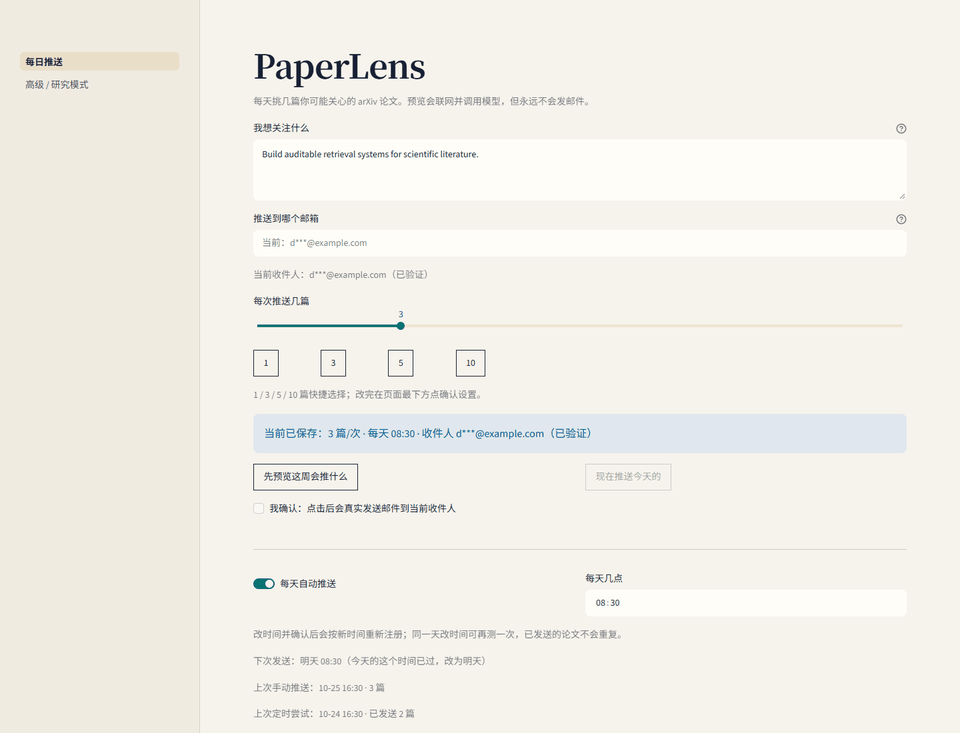
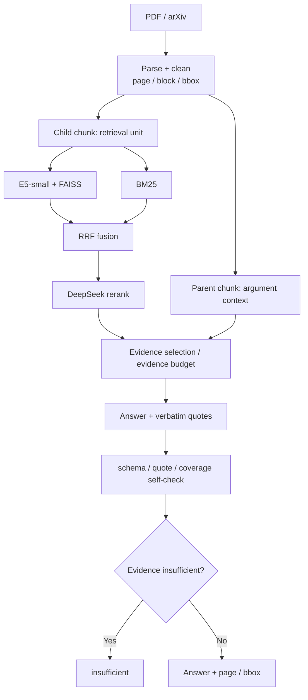
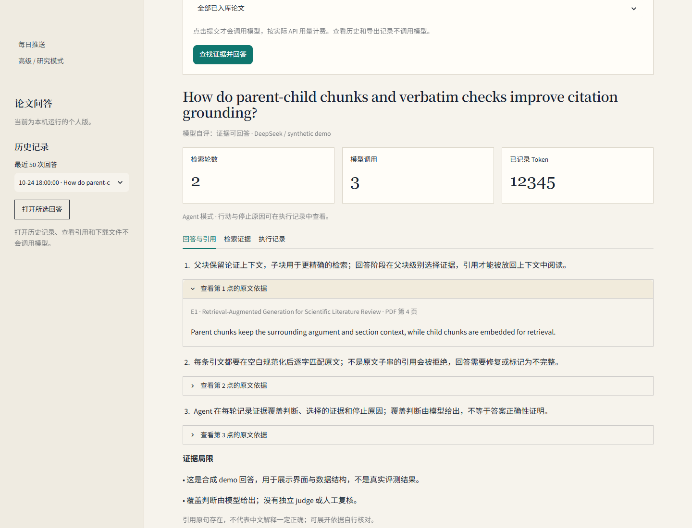
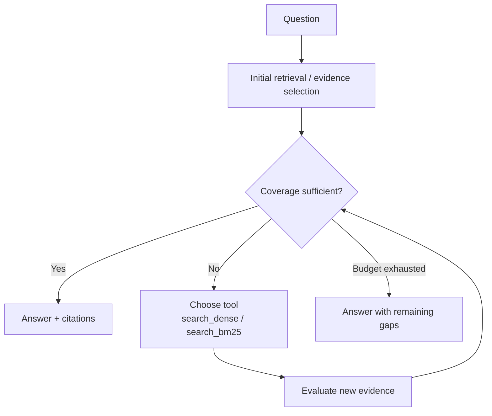
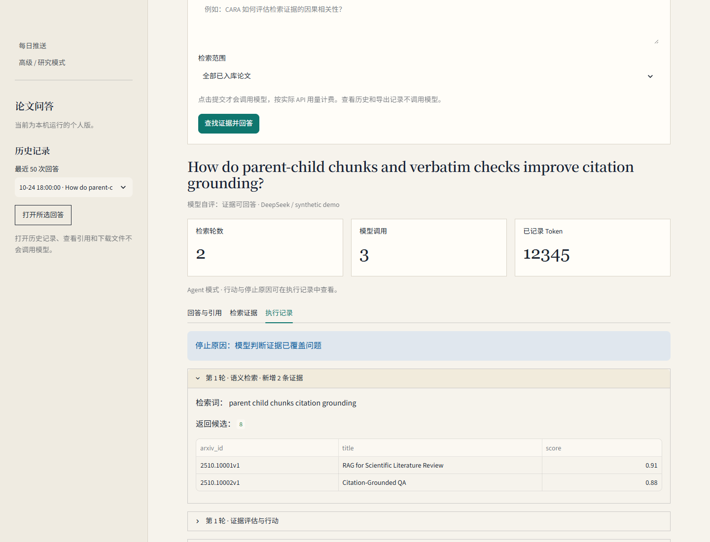
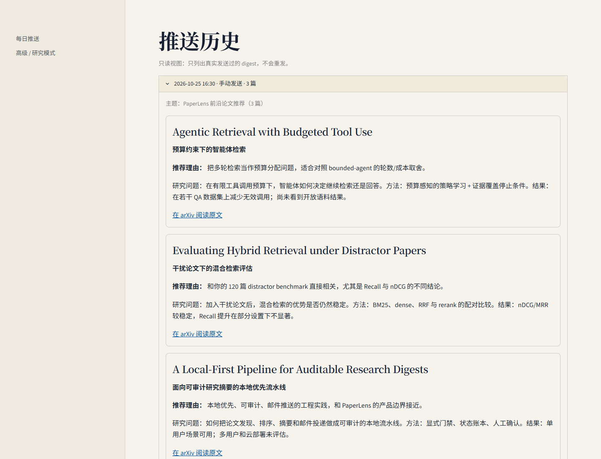
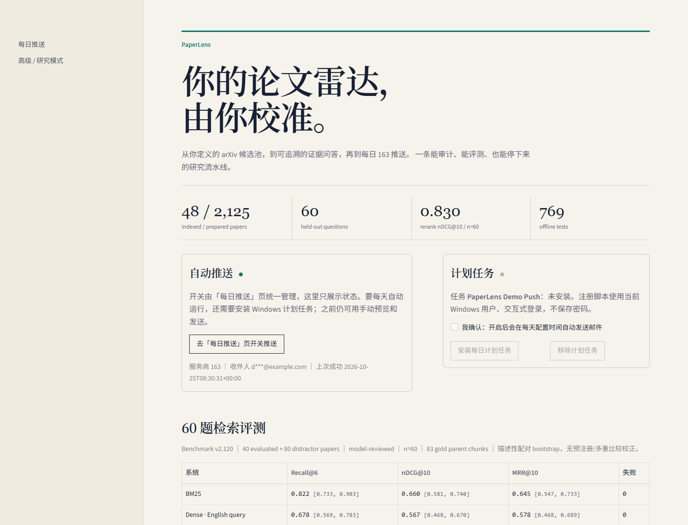
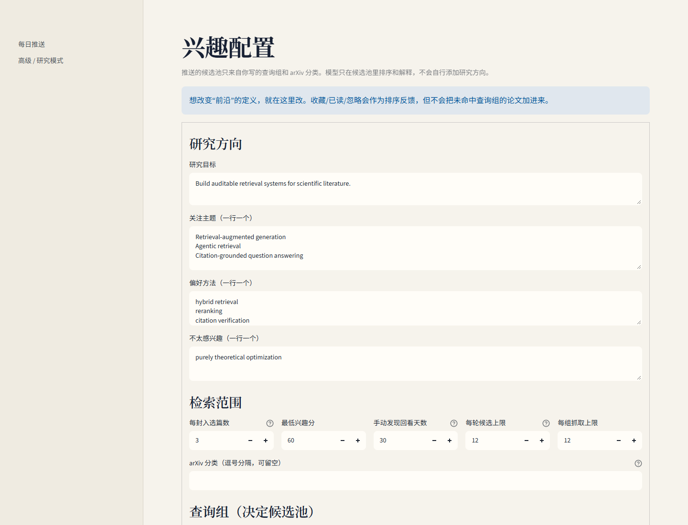
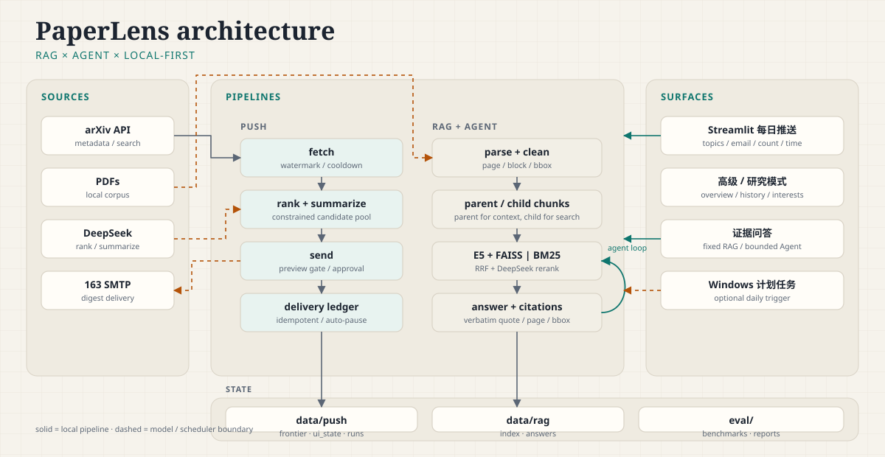

<div align="center">

<h1> PaperLens</h1>

<p><strong>A local-first, RAG- and Agent-based assistant for personalized paper discovery and evidence Q&A</strong></p>

<p>Recommendations with reasons · Answers with verbatim citations · Pushes with an audit trail · Local-first by default</p>

<p>
<a href="https://www.python.org/"></a>
<a href="https://streamlit.io/"></a>
<a href="#tests"></a>
<a href="LICENSE"></a>
<a href="#privacy"></a>
</p>

<p><a href="#quickstart">Quick start</a> · <a href="#features">Features</a> · <a href="#screenshots">Screenshots</a> · <a href="#rag">RAG</a> · <a href="#agent">Agent</a> · <a href="#architecture">Architecture</a> · <a href="#evaluation">Evaluation</a> · <a href="#privacy">Privacy</a></p>

<p><a href="README.md">English</a> | <a href="README.zh-CN.md">简体中文</a></p>

<p><strong><a href="docs/screenshots/demo.gif">▶ Watch the demo GIF</a></strong></p>

</div>

<p align="center">
  
</p>

> Animated UI tour, all using **synthetic demo data**: daily digest → interest groups → evaluation overview → push history → evidence Q&A → agent trace. None of it reflects the author's real interests, questions, or push history.

<a id="what"></a>
## ✨ What is PaperLens

PaperLens is a **paper digest assistant**: it uses RAG and an Agent for personalized paper discovery, evidence Q&A, and daily digests. It is local-first, and the three core capabilities form a pipeline whose steps can be paused and inspected:

- **Personalized discovery**: you write a topic → it generates 1–3 arXiv query groups → the candidate pool comes only from those query groups and arXiv categories. The model only ranks and explains within the candidate pool; it does not expand the research direction on its own.
- **Evidence Q&A**: ask questions about a paper's full text and get verbatim quotes, page/bbox, plus schema and coverage self-checks; when evidence is insufficient it explicitly returns `insufficient` instead of forcing an answer.
- **Daily digest**: ranks the day's candidates, generates a Chinese summary, and sends it via 163 SMTP. Preview never sends email; real sends require manual approval; a delivery ledger prevents duplicates.
- **Reproducible evaluation**: a 60-question held-out benchmark, BM25/dense/RRF/rerank comparisons, answer-level citation metrics, and an A/B harness for fixed RAG vs bounded Agent.

<a id="why"></a>
## 🆚 Why not just another chat box

| Common approach | What PaperLens does |
|---|---|
| The model freely decides what to search | The candidate pool is explicitly defined by your query groups + arXiv categories; the model only ranks |
| Citations just need to look right | Verbatim quote validation, page/bbox, schema/coverage self-checks |
| Reports only one "accuracy" number | Separates retrieval / citation / answer-level; does not package citation metrics as accuracy |
| Cloud by default, upload your data | Local-first; `data/` and `.env` stay out of the repository; no telemetry |
| Pushes cannot be audited | preview/send gates, delivery ledger, watermark, failure auto-pause |

<a id="features"></a>
## 🚀 Feature overview

| Module | Capability | Design |
|---|---|---|
| **Personalized discovery** | Topic → 1–3 arXiv query groups → candidate pool; the model ranks and explains only within the pool | Query groups are explicit and inspectable; no silent expansion of research directions |
| **RAG evidence Q&A** | Parent/child chunks, E5 + FAISS, BM25, RRF, DeepSeek rerank, verbatim quotes | Quotes must trace back to the source text; page/bbox can be verified |
| **Bounded Agent** | Supplementary retrieval when evidence is insufficient; at most 3 rounds / 4 model calls / 6 pieces of evidence | Budgets, decision JSON, stop_reason, full trace |
| **Daily digest** | Topic, email, number of papers, time; preview does not send, test email, manual/automatic push | preview/send gates, delivery ledger, watermark, automatic pause |
| **Evaluation** | 60-question retrieval benchmark, 120 distractor papers, answer-level citations, Agent A/B harness | Separates retrieval / citation / answer-level; not packaged as accuracy |
| **Privacy** | `data/`, `.env`, real profile not in the repository; UI masks email; no telemetry | Single-user local-first; public demos must use synthetic data |

### 🧱 Tech stack

| Layer | Technology | Responsibility |
|---|---|---|
| Interaction and presentation | **Streamlit 1.66** | Daily digest, test email, advanced research pages, push history |
| Retrieval | **E5-small + FAISS + BM25 + RRF** | Semantic/keyword retrieval, parent-chunk fusion |
| Reranking and answering | **DeepSeek (OpenAI-compatible)** | Candidate reranking, Chinese summaries, evidence Q&A |
| Storage | **SQLite + JSON** | frontier / runs / ui_state / profile |
| Delivery | **163 SMTP + Windows Task Scheduler** | Daily digest, manual send, optional scheduled task |
| Parsing | **PyMuPDF** | PDF parsing; note the AGPL/commercial dual license |
| Testing | **unittest** | 769 offline tests; Playwright only for synthetic demo screenshots |

<a id="rag"></a>
## 🔬 RAG pipeline

PaperLens's RAG is not "throw the top-k at the model"; it makes **provenance, chunking, retrieval, reranking, and citation** all inspectable steps:



- **Traceable provenance**: every passage keeps its arXiv id, PDF page, block/bbox, and parent/child relationship; the manifest uses a hash chain.
- **Comparable retrieval**: BM25 / dense E5 / RRF / rerank can all run on the same benchmark; results below.
- **Verifiable citations**: a quote must be a whitespace-normalized substring of the source text; page/bbox lets you go back to the original.
- **Refusal when evidence is insufficient**: returns `insufficient` when evidence coverage is insufficient, without fabricating.

**Data scale**

| Asset | Count | Notes |
|---|---:|---|
| prepared full text | 2,125 papers / 42,682 pages / ~151.5 million characters | not an indexed corpus |
| Product index | 48 papers / 16,648 parent chunks / 2,997 vectors | 8 dev + 40 benchmark |
| Retrieval benchmark | 120 papers (40 evaluated + 80 distractor) | 60 questions |
| qrels | 145 gold points → 132 mapped / 83 parent chunks | 13 unmapped; 40/60 questions have only 1 gold parent |
| Offline tests | 769 | 753 + 16 |

**Retrieval and citation contract**

| Stage | Implementation | Inspectable checkpoint |
|---|---|---|
| Parsing / cleaning | PyMuPDF; page / block / bbox; no OCR | page-level structure checks |
| Parent / child chunks | parent chunks preserve context, child chunks do retrieval; child offsets/text must match parent | `retrieval_core.load_index` structural validation |
| Vectors | `intfloat/multilingual-e5-small`, 384d, normalized, FAISS `IndexFlatIP` | dimension / normalization / duplicate IDs |
| Keywords | BM25Okapi `k1=1.5, b=0.75`; English queries | parent-chunk deduplication |
| Fusion | RRF (dense + BM25) | parent-chunk-level fusion |
| Reranking | DeepSeek LLM rerank | candidate / evidence budgets |
| Answering | answer points + citations; quote must be a whitespace-normalized substring of the source | verbatim quotes; formula expansion ≤800 characters |
| Quality | schema / coverage self-check | structure and numbering consistency; does not judge semantic correctness |
| Refusal | insufficient evidence → `insufficient` | 12/12 out-of-scope checks |

**Chinese query rewrite**: `query_rewrite.py` performs a page-blind translation from a Chinese question to an English retrieval query; it sees only the question, never the retrieval results. It includes caching and failure fallback, and can be disabled with `PAPERLENS_QUERY_REWRITE=0`. A one-off Chinese smoke test was run on the 48-paper product index; there is no formal comparison yet, so no benefit can be claimed.

**Answer-level metrics (n=60, reusing rerank evidence from 120 papers, including one repair)**

| Metric | Value | Basis |
|---|---:|---|
| answered / partial / invalid | 47 / 9 / 4 | n=60 |
| schema + verbatim quote | 93.3% | deterministic; not correctness |
| cited gold-parent recall | 82.2% [0.722, 0.917] | conservative definition |
| gold-point citation recall | 77.4% [0.676, 0.864] | conservative definition |
| cited gold-parent precision | 62.9% | answered/partial (n=56) |
| citation occurrence gold-quote precision | 68.1% | same as above |
| tokens | 169,306 | one repair |
| p95 latency | 5.38s | |

**Honest boundaries of the benchmark**

- model-reviewed, `human_reviewed=false`; no human verification, κ, or independent judge.
- 13/145 gold points are not mapped to a parent chunk; 40/60 questions have only 1 gold parent.
- query audit: queries and gold quotes overlap by an average of 40.8% of tokens, and 5/60 have 4-gram overlap; the benchmark may still be on the easy side.
- The 40-paper closed-world rerank Recall@6 of 0.908 **cannot** be treated as an open-corpus conclusion; with 80 distractor papers it is 0.872, and the Recall CI relative to BM25 crosses 0.
- repair only fixes schema/quotes; it does not judge whether a claim is correct. This is not answer accuracy / faithfulness.

**RAG code map**

| File | Purpose |
|---|---|
| `ingest_library.py` / `clean_corpus.py` / `library_transaction.py` | PDF ingestion, cleaning, parent/child chunks, hash chain, and atomic publish |
| `build_vector_index.py` / `retrieval_core.py` | E5 384d + FAISS, BM25, RRF, parent validation |
| `search_evidence.py` / `search_bm25.py` / `rerank_evidence.py` | semantic retrieval, keyword retrieval, LLM reranking |
| `query_rewrite.py` | page-blind Chinese query rewrite |
| `answer_question.py` / `answer_schema.py` / `answer_quality.py` | answer, schema, verbatim quotes, coverage self-check |
| `run_qa.py` | fixed RAG CLI |
| `eval/` | benchmark, qrels, retrieval/answer reports |



> Synthetic demo answer: shows the answer, retrieval rounds, tokens, and verbatim quotes; not real evaluation results.

<a id="agent"></a>
## 🤖 Agent: budgeted supplementary retrieval

Fixed RAG is "one retrieval → one answer". PaperLens also implements a **bounded Agent**: it can retrieve more when evidence is insufficient, but rounds, evidence, and model calls all have budgets, and every step leaves a trace.



- **Tools**: `search_dense` (E5/FAISS semantic retrieval) and `search_bm25` (keyword retrieval).
- **Budget**: at most 3 retrieval rounds, 4 model calls, and 6 pieces of evidence; it stops when a budget is reached, with no infinite loop.
- **Auditable**: `agent_trace` records each round's query, candidates, coverage self-assessment, selected evidence, and stop reason; `agent.stop_reason` explains why it stopped.
- **Comparison**: `eval/agent_eval.py` compares `fixed_rag`, `agent_single`, and `agent_multi` with the same evidence budget and the same answer prompt; it outputs schema/quote/citation recall, tool calls, rounds, tokens, and latency.
- **Honest boundaries**: the harness passes 31 offline tests; the real paid pilot has only n=5 and no significance; the full 60-question A/B has not been run. No multi-round benefit or cost conclusion can be claimed.

**Tools (read-only)**

| Tool | Retrieval method | Language | Constraints |
|---|---|---|---|
| `search_dense` | E5 + FAISS semantic retrieval | Chinese / English | query length and token limit validation |
| `search_bm25` | BM25Okapi keywords | English | Chinese queries are rejected |

Tools are read-only: no network access, no code execution, no file writes, no email; `paper_filter` is fixed, so the Agent cannot expand the paper scope on its own.

**Decision JSON**

| Field | Allowed values / constraints |
|---|---|
| `assessment` | `sufficient` / `partial` / `insufficient`; must be consistent with selected/missing/action |
| `missing` | at most 6 items, each 1–300 characters; must be empty for sufficient, non-empty for partial/insufficient |
| `selected_ids` | at most 6, must come from candidates; at least 1 for sufficient/partial; empty for insufficient |
| `action` | `search_dense` / `search_bm25` / `finish`; query is empty when finishing; BM25 only accepts English |
| `query` | ≤500 characters; non-finish must have a valid query |
| `reason` | 1–240 characters, a short user-facing rationale for the action; no internal reasoning |

**Budget and limits**

| Limit | Value |
|---|---:|
| Retrieval rounds | 3 |
| Model calls | 4 |
| Answer evidence | 6 |
| decision output tokens | 1,600 |
| answer output tokens | 4,096 |
| API timeout | 120s |
| automatic retries | 0 |

**Stop reasons**

| `stop_reason` | Meaning |
|---|---|
| `sufficient` | The model judges that evidence covers the question |
| `model_stopped_with_gaps` | Ends retrieval while keeping the gaps |
| `round_budget` | Reached the retrieval round limit |
| `call_budget` | Reached the model call budget, reserving the final answer |
| `repeated_query` | Blocked a duplicate query |
| `no_new_evidence` | Supplementary retrieval brought no new evidence |
| `empty_retrieval` | No usable evidence was retrieved |

**Execution trace**

| event | Fields |
|---|---|
| `retrieval` | `round`, `tool`, `query`, `new_count`, `candidate_count`, `sources` |
| `decision` | `round`, `assessment`, `reason`, `action`, `selected_ids`, `missing` |

`agent_trace` is an execution record, not proof that the answer is correct; coverage judgment is made by the model, and the program only validates structure and consistency.

**A/B harness**

| Mode | Behavior | Same constraints |
|---|---|---|
| `fixed_rag` | one retrieval + one answer | 6-evidence budget; same answer prompt |
| `agent_single` | 1 decision round + answer | same as above |
| `agent_multi` | up to 3 supplementary retrieval rounds | same as above |

The harness outputs schema/quote, cited gold parent, gold-point citation, tool calls, rounds, tokens, and latency; 31 offline tests pass. The real pilot is n=5, only for harness validation and descriptive observation, not a benefit conclusion.

**It is not**: a general tool-use agent, a browser/code executor, a multi-agent system, or a fine-tuned model. It is only a **budgeted local retrieval controller**; there are no multi-round benefit, cost, or generalization conclusions.



> Synthetic demo trace: shows retrieval rounds, candidates, evidence coverage, stop reason, and tokens; not real evaluation results. See [README_AGENT_EVAL.md](README_AGENT_EVAL.md) for details.

<a id="engineering"></a>
## 🧩 Engineering challenges

### 01 · Parent/child chunks and verbatim quotes

**Problem:** retrieval units that are too small lose context, while units that are too large reduce recall; model-generated citations also often "look like the source" without actually being so.

**Handling:** parent chunks preserve argument context, child chunks perform retrieval; `retrieval_core` validates that child offsets/text fall inside the parent; quotes must be substrings of the source after whitespace normalization, with limited expansion allowed for formulas (≤800 characters); page/bbox are stored with the evidence.

**Trade-off:** verbatim validation proves "the quote exists", not "the claim is correct"; formula expansion and sentence-boundary checks can still miss issues or raise false positives.

### 02 · Distribution shift in retrieval evaluation

**Problem:** high Recall on 40 papers in a closed world does not represent an open corpus; adding distractors can make Recall unstable.

**Handling:** built a 120-paper corpus (40 evaluated + 80 distractor), 60 questions, and parent-chunk qrels; reports Recall@6 / nDCG@10 / MRR@10 together; ran a query audit (queries and gold quotes overlap by an average of 40.8% of tokens, and 5/60 have 4-gram overlap), and explicitly states that 13/145 gold points are unmapped.

**Trade-off:** the main result is still a fixed 120-paper, model-reviewed benchmark without preregistration; the 40-paper rerank Recall of 0.908 is only a historical comparison and cannot be extrapolated.

### 03 · Agent budget and stopping

**Problem:** "let the model search a few more rounds" easily turns into infinite loops, duplicate queries, runaway cost, or passing off "retrieved something" as "a complete answer".

**Handling:** fixed 3 rounds / 4 model calls / 6 pieces of evidence; decision JSON enforces consistency across `assessment`, `missing`, `selected_ids`, and `action`; `stop_reason` records sufficient / round_budget / call_budget / repeated_query / no_new_evidence, etc.; every action is traced.

**Trade-off:** the harness has only an n=5 pilot, with no significance; the full 60-question A/B has not been run, so no multi-round benefit or cost conclusion can be claimed.

### 04 · Push idempotency and safety

**Problem:** duplicate sends, previews that send by mistake, and uncertain state after failures all undermine trust in the "daily digest".

**Handling:** previews read only a copy of the production frontier and never touch SMTP; real sends require email verification + first-send approval + confirmation; a delivery ledger prevents duplicates; a watermark controls the window; when an SMTP result is uncertain, mark it `uncertain` and pause automatically.

**Trade-off:** SMTP accepted ≠ inbox; no bulk deliverability or unsubscribe statistics; the scheduled task depends on the machine being powered on and logged in.

### 05 · Local-first and privacy

**Problem:** paper interests, question history, and push records are personal data; once mixed into a public app, they are easy to expose or mishandle.

**Handling:** `data/`, `.env`, and real profiles are all gitignored; the UI only shows masked email addresses; RAG/push/evaluation all read local directories; the public repo ships only `interests.example.json`; screenshots use a separate synthetic demo.

**Trade-off:** the app is single-user and has no authentication; do not expose it to the public internet. For remote access, use an SSH tunnel/Tailscale; a public demo must use synthetic data and disable real SMTP/model calls.

<a id="screenshots"></a>
## 📸 Screenshots of the running app

> The screenshots below use **synthetic demo data**: fake email addresses, fake papers, and fake Q&A/Agent traces; they are not the author's real interests, questions, or push history.

| Push history | Overview and evaluation |
| :---: | :---: |
|  |  |

| Precise interest groups | RAG answer with verbatim quotes |
| :---: | :---: |
|  |  |

The Agent execution trace is shown in the [Agent](#agent) section; all images are in `docs/screenshots/`.

<a id="architecture"></a>
## 🏗️ Architecture



All personal data lives in `data/` (gitignored); `.env` is read only on the local machine. The public repository ships only the generic `interests.example.json` sample.

<a id="quickstart"></a>
## ⚡ Quick start

### Environment

- Windows 10/11
- Python 3.11
- Full UI + RAG: `requirements.txt`
- Push only (suitable for a small VPS): `requirements-push.txt`

```powershell
git clone https://github.com/<your-name>/paperlens.git
cd paperlens

python -m venv .venv
.\.venv\Scripts\activate
pip install -r requirements.txt

copy .env.example .env
notepad .env
```

Fill in the DeepSeek key, SMTP authorization code, and recipient in `.env`; do not commit `.env`.

### Start / stop

```powershell
# One-click start: opens the browser, default http://127.0.0.1:8501/
.\start.bat

# Stop
.\stop.bat
```

`start.bat` uses `python` from PATH by default. If double-clicking cannot find the virtual environment, set it first:

```powershell
set PAPERLENS_PYTHON=D:\path\to\paperlens\Scripts\python.exe
.\start.bat
```

Or start manually:

```powershell
python -m streamlit run app.py
```

### First push

1. On the **Daily digest** page, write a topic, enter the recipient email, and choose the number of papers (1–10) and a daily time.
2. Click **Preview what will be pushed this week** — it fetches, ranks, and generates a preview, **without sending email**.
3. Click **Send test email** and confirm receipt in your inbox.
4. Check **I received it, enable push**. This step completes both email verification and first-send approval.
5. To send once right away, check the confirmation and click **Push today's digest now**; **manual sending does not turn on the automatic switch**.
6. After that, use **Daily automatic push** to start and stop with one click.

### Windows scheduled task

```powershell
powershell -ExecutionPolicy Bypass -File scripts\register_push_task.ps1
powershell -ExecutionPolicy Bypass -File scripts\unregister_push_task.ps1
```

The scheduled task is optional; if it is not registered, manual preview and send on the page still work. By default the task runs only in your logged-in session, and it will not send on time when the computer is off or asleep.

<a id="evaluation"></a>
## 📊 Evaluation

The main results use **60 questions over a 120-paper corpus (40 evaluated papers + 80 distractor papers)** with retrieval-level metrics; this is a model-reviewed benchmark, not human verification.

| System | Recall@6 | nDCG@10 | MRR@10 |
|---|---:|---:|---:|
| BM25 | 0.822 | 0.660 | 0.645 |
| Dense E5 · English query | 0.678 | 0.567 | 0.578 |
| Dense E5 · Chinese query | 0.142 | 0.082 | 0.069 |
| RRF hybrid | 0.808 | 0.655 | 0.638 |
| **RRF + DeepSeek rerank** | **0.872** | **0.830** | **0.838** |

- 2/60 failures are counted as 0; rerank used ~399,725 tokens.
- Paired bootstrap results are **descriptive**; there is no preregistration or multiple-comparison correction.
- The 40-paper closed-world rerank Recall@6 of 0.908 **must not** be treated as open-corpus capability; with distractors it is 0.872, and the +0.050 Recall CI relative to BM25 crosses 0.

Answer-level metrics (n=60, reusing rerank evidence from 120 papers, including one repair):

- 47 answered / 9 partial / 4 invalid
- schema + verbatim quote pass rate **93.3%**
- cited gold-parent recall **82.2%**
- gold-point citation recall **77.4%**
- Refusal/out-of-scope: **12/12 returned `insufficient`**

**This is not answer accuracy / correctness / faithfulness.** There is no independent judge and no human review; repair only fixes schema/quotes and does not judge whether claims are correct.

Agent A/B: the fixed RAG vs bounded Agent harness is implemented (31 offline tests), and a real paid pilot on 5 questions has been run (n=5, citation-level):

| Mode | answered / 5 | schema+quote | cited gold parent | gold-point | tokens |
|---|---:|---:|---:|---:|---:|
| fixed_rag | 4 | 0.800 | 0.800 | 0.600 | 12,967 |
| agent_single | 2 | 1.000 (n=3) | 0.200 | 0.200 | 29,297 |
| agent_multi | 4 | 1.000 | 0.600 | 0.500 | 58,418 |

**The sample is too small, with no CI and no significance; the full 60-question A/B has not been run.** This table only shows that the harness works and descriptive differences; it is not answer accuracy, and it cannot support multi-round benefit or cost conclusions.

Detailed reports:

- [README_EVAL.md](README_EVAL.md)
- [README_ANSWER_EVAL.md](README_ANSWER_EVAL.md)
- [README_ANSWER_REPAIR.md](README_ANSWER_REPAIR.md)
- [README_AGENT_EVAL.md](README_AGENT_EVAL.md)
- [eval/CLAIMS.md](eval/CLAIMS.md)

> **Do not describe these numbers as**: answer accuracy, faithfulness, human-verified, open-corpus SOTA, effective personalized ranking, daily push in production, or multi-round Agent benefit.

<a id="tests"></a>
## ✅ Tests and CI

```powershell
python -m unittest discover -s tests -v
python -m unittest discover -s . -p "test_eval.py" -v
```

The current public tree has **753 tests** in `tests/` (2 skipped) + **16 tests** in `test_eval.py`, **769 total**; **767 passed / 2 skipped**. All tests run offline and do not access arXiv/SMTP/DeepSeek.

`.github/workflows/ci.yml` already contains a GitHub Actions workflow; it has not actually run in the current GitHub repository yet, so this README does not claim "CI is green".

<a id="structure"></a>
## 📁 Project structure

```text
app.py, simple_page.py, simple_ui.py   Default Daily digest page and Streamlit-free subscription logic
advanced/                              Advanced / research mode: overview, evidence Q&A, push settings,
                                       precise interest groups, paper library, discovery, push history
push_*.py                              arXiv fetching, ranking, summaries, SMTP, delivery ledger
answer_*.py, run_qa.py                 Fixed RAG and answer validation
run_agent.py, agent_*.py               Bounded Agent
search_*.py, rerank_*.py               Retrieval, BM25, reranking
eval/                                  Evaluation assets and claims ledger
scripts/                               Windows scheduled tasks, privacy scan, test entry points
tests/                                 Offline tests
docs/                                  PUSH / EVAL / design docs
```

<a id="privacy"></a>
## 🔒 Privacy and security

PaperLens is a **single-user, local-first** tool, not a multi-tenant service.

- **Data does not enter Git**: `data/`, `.env`, real profiles, Q&A records, and push history are all in `.gitignore`; the public repository ships only `interests.example.json`.
- **Email masking**: the UI, state JSON, and logs show only masked recipients; the raw address exists only in `data/push/ui_state.json`.
- **No telemetry**: no analytics, no cloud backend.
- **Pre-release scan**:

  ```powershell
  python scripts/check_public_repo.py
  python scripts/check_public_repo.py --history
  ```

  By default it scans tracked files for real email addresses, `sk-` keys, and non-placeholder `SMTP_PASSWORD=`; `--history` additionally performs a read-only audit of history, reporting only paths/commits and never rewriting history.

- **Do not expose a personal instance to the public internet**: the advanced research pages read the local `data/` directory (interest groups, Q&A history, push history, recently delivered papers), and the app has no login or multi-user isolation. For remote access, use an SSH tunnel/Tailscale, or keep it on a private network.
- **Public demo**: use synthetic data, disable real SMTP/model calls, and hide or disable personal-data pages; do not attach a real `data/` directory or `.env` to the demo.
- See [PRIVACY.md](PRIVACY.md) for more details.

<a id="measured"></a>
## 🧪 Measured / not measured

**Measured**

- 48-paper product index (8 dev + 40 benchmark), 16,648 chunks, 2,997 E5-small 384-dimensional vectors.
- Page-level structure checks on 2,125 prepared full-text papers (42,682 pages).
- 60-question retrieval benchmark + 120-paper distractor comparison + answer-level citation metrics + refusal checks.
- One local SMTP smoke send was accepted; **SMTP accepted ≠ inbox**; no bulk deliverability conclusion.
- 769 offline tests pass.

**Not measured / cannot claim**

- General conclusions about end-to-end answer accuracy, faithfulness, or citation precision/recall.
- Personalized ranking benefit (only impression logs, no ranking metric).
- Agent multi-round benefit (only an n=5 pilot, no significance).
- Multi-day scheduling, on-time delivery rate, bounce, or unsubscribe statistics.
- Generalization to an open corpus; the main benchmark is still a fixed 120-paper corpus.

<a id="limits"></a>
## 🧭 Limitations and roadmap

- The large corpus of 2,125 papers is prepared, but the product index is 48 papers; prepared must not be described as "indexed/searchable".
- The benchmark is model-reviewed; `human_reviewed=false`, with no human verification or κ.
- The licenses of 2,133 paper records have not been verified individually; the repository does not distribute PDFs or full text.
- Windows Task Scheduler depends on the machine being powered on and logged in; it is not a cloud service.
- This project is not an official implementation by the paper authors; see each manifest for citations and data sources.

**Roadmap**

- [x] 60-question retrieval benchmark + 120 distractors
- [x] Answer-level citation / refusal metrics
- [x] Fixed RAG vs bounded Agent harness + 5-question pilot
- [x] Simple push page, `stop.bat`, synthetic demo screenshots
- [ ] Human review / independent judge
- [ ] Full 60-question Agent A/B
- [ ] Public demo mode (synthetic data, real sends disabled)
- [ ] Cloud scheduler (VPS / GitHub Actions)

<a id="docs"></a>
## 📚 Documentation

- [docs/PUSH.md](docs/PUSH.md) — push, gates, scheduled tasks, troubleshooting
- [README_EVAL.md](README_EVAL.md) — retrieval/answer evaluation
- [README_AGENT_EVAL.md](README_AGENT_EVAL.md) — fixed RAG vs bounded Agent A/B
- [PRIVACY.md](PRIVACY.md) — data flows and local-first boundaries

<a id="license"></a>
## 📄 License

The code is under the **MIT License**; arXiv metadata, paper excerpts, model outputs, datasets, and third-party dependencies are **not licensed here** — see [NOTICE](NOTICE) and [THIRD_PARTY.md](THIRD_PARTY.md) for details. **PyMuPDF is AGPL-3.0 / commercial dual-licensed**; if you need closed-source or commercial distribution, evaluate or replace it separately. The repository does not contain PDFs or full text. This is not legal advice.
